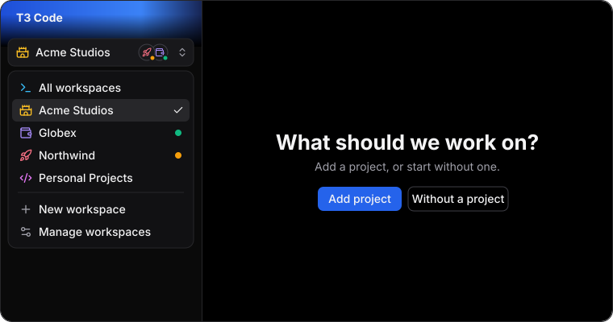

<div align="center">



# T3 Code with Workspaces

An unofficial fork of [T3 Code](https://github.com/pingdotgg/t3code) that gives every client or project its own threads and projects, on top of your normal setup.

[](https://github.com/camdencove/t3code/releases/latest)
[](./LICENSE)

**[Download](https://github.com/camdencove/t3code/releases/latest)** · [Run it on a server](#run-it-on-a-server) · [Upstream docs](#t3-code)

</div>

## Workspaces

If you work across several clients or companies, their threads should not share one pile. A workspace keeps them apart and inherits everything else from Default.

- **Inherits by default.** Each workspace runs its own T3 Code server with its own projects and threads. It uses your existing logins, tools and MCP servers, and starts with a copy of your T3 Code settings, so it works straight away.
- **Separate what you need.** Turn on separate Claude, Codex or GitHub CLI config under **Settings → Workspaces**, then sign in with that tool's own login command in a terminal in the workspace, such as `claude auth login`. Existing threads for that tool can't continue after you change this.
- **Override anything else.** Add environment variables per workspace, such as `AWS_PROFILE` or `GIT_CONFIG_GLOBAL`.
- **One click to switch.** Pick a workspace from the sidebar or the command palette, or press `mod+alt+w`. **All workspaces** shows everything at once. Every workspace starts with the app, so scheduled tasks keep running. When another workspace is waiting on you, its icon appears on the switcher, and and `mod+alt+j` opens whatever has been waiting longest. `mod+alt+1` to `9` jump straight to a workspace. Set icons, rename Default and All workspaces and drag to reorder under **Settings → Workspaces**.
- **No crossed wires.** New threads stay in the workspace you are in, and load balancing and PR routing leave workspaces out.
- **Remote environments.** An SSH or paired server shows in every workspace by default. To keep it in one workspace, pick that workspace under **Settings → Workspaces**. Agents there use that server's logins, so a workspace's separate logins and environment variables don't apply.

To keep client MCP servers apart without a separate login, skip global servers and define them per project: `claude mcp add --scope local`, or a `.mcp.json` in the repo. A `.mcp.json` in a parent folder also works, but not in worktrees outside that folder.

Only what you turn on is separate. Cursor, OpenCode, Grok, Kiro, Antigravity, your git identity and your SSH keys always come from your normal setup unless you override them with environment variables.

Workspaces are a desktop app feature. To use one from another device, turn on **Network access** under **Settings → Sharing & access**, then choose **Copy export link** on that workspace under **Settings → Workspaces** and paste the link into **Add environment** on the other device. It appears in that device's switcher with its name and icon. Each workspace needs its own link, and any other environment you add appears in the switcher too.

## Download

Grab the installer for your machine from the [latest release](https://github.com/camdencove/t3code/releases/latest). Windows x64, macOS Apple Silicon and Linux (x64 and arm64) are all there.

The builds are unsigned, so Windows and macOS will warn you the first time you open the app. On Windows choose **More info**, then **Run anyway**. On macOS allow it under **System Settings → Privacy & Security**.

## Run it on a server

The easy way is SSH from the desktop app. Open **Settings → Connections**, add an environment, choose **SSH** and enter your host, such as `user@example.com`. T3 Code installs the matching CLI on the server, starts it and forwards the port for you.

To install the CLI yourself:

```bash
curl -fsSL https://raw.githubusercontent.com/camdencove/t3code/main/scripts/install.sh | sh
```

Then run `t3`. The server needs Linux or an Apple Silicon Mac, plus your agent's CLI signed in. The [remote access guide](./docs/user/remote-access.md) has the details.

## How this fork differs

- **T3 Connect is off.** It depends on T3's hosted services, so use SSH, your LAN or Tailscale.
- **Telemetry works as it does upstream.** Set `T3CODE_TELEMETRY_ENABLED=false` to turn it off.
- **Upstream changes come in by merge.** The fork stays a small set of commits on top of T3 Code.

All credit for T3 Code goes to its [authors](https://github.com/pingdotgg/t3code). This fork is not affiliated with or supported by them, so please report fork issues [here](https://github.com/camdencove/t3code/issues). Released under the [MIT License](./LICENSE).

---

_The rest of this page is the upstream README. Its install commands and links point to the official T3 Code, without workspaces._

<p align="center">
  <a href="https://t3.codes">
    
  </a>
</p>

<h1 align="center">T3 Code</h1>

<p align="center">The open-source control plane for coding agents.</p>

<p align="center">
  <a href="https://t3.codes/download"><strong>Download</strong></a> ·
  <a href="https://apps.apple.com/us/app/t3-code-remote-claude-more/id6787819824">iOS</a> ·
  <a href="https://play.google.com/store/apps/details?id=com.t3tools.t3code">Android</a> ·
  <a href="https://app.t3.codes">Web</a> ·
  <a href="./docs/README.md">Docs</a> ·
  <a href="https://discord.gg/jn4EGJjrvv">Discord</a>
</p>

<p align="center">
  <a href="https://t3.codes">
    
  </a>
</p>

T3 Code runs the coding agents on your machine and gives them one fast interface. Start a thread at your desk, then approve the next step from your phone.

It works with Claude Code, Codex, Cursor, OpenCode, Grok Build, Antigravity, Kiro, Pi, Muse Code, fx, and any [ACP](./docs/user/providers-acp.md) agent. If an agent is set up on your computer, T3 Code can control it.

## What you get

- **Your subscriptions.** T3 Code does not resell tokens. It drives the agents you are already signed in to.
- **Every agent in one place.** Change models in the middle of a thread. Let Claude hand a task to Codex.
- **Desktop, web, and phone.** One server, and every client shows the same threads. There are apps for iOS and Android.
- **Remote ready.** Run agents on any machine. Connect over your local network, Tailscale, or [T3 Connect](./docs/user/remote-access.md).
- **Git built in.** Each thread can work in its own worktree. Review the diff, then commit, push, and open a pull request with one button.
- **Fast.** Performance is a feature here. We measure it, and we treat a dropped frame as a bug.
- **Open.** MIT licensed. If you don't like something, fork it.

## Install

### Desktop app

[Download T3 Code](https://t3.codes/download) for macOS, Windows, or Linux. You can also use a package manager:

| Platform       | Command                                                              |
| -------------- | -------------------------------------------------------------------- |
| macOS          | `brew install --cask t3-code`                                        |
| Windows        | `winget install T3Tools.T3Code` or `scoop install extras/t3code`     |
| Arch Linux     | `yay -S t3code-bin`                                                  |
| Nix            | `nix profile add github:NixOS/nixpkgs/nixos-unstable#t3code`         |
| Debian, Ubuntu | `.deb` from [Releases](https://github.com/pingdotgg/t3code/releases) |

### Command line

This installs the `t3` command. Run `t3` to start the server and open the web app.

```bash
curl -fsSL https://t3.codes/install.sh | sh
```

On Windows, in PowerShell:

```powershell
irm https://t3.codes/install.ps1 | iex
```

To try it once without an install, run `npx t3@latest`.

### Phone

Get the app from the [App Store](https://apps.apple.com/us/app/t3-code-remote-claude-more/id6787819824) or [Google Play](https://play.google.com/store/apps/details?id=com.t3tools.t3code). Then follow [remote access](./docs/user/remote-access.md) to connect it to your computer.

### Sign in to an agent

T3 Code needs one agent that is installed and signed in. For example, install [Claude Code](https://claude.com/product/claude-code) and run `claude auth login`, or install [Codex CLI](https://developers.openai.com/codex/cli) and run `codex login`.

[Provider setup](./docs/user/install.md#providers) has the steps for each agent. [Install T3 Code](./docs/user/install.md) covers nightly builds, AppImage, WSL, and NixOS.

## "Wait, what are you selling me?"

Nothing. We built T3 Code because we wanted the best possible development experience with agents. We were inspired by existing solutions like the Codex desktop app, Conductor, Claude Desktop and Cursor Glass, but none met our bar.

We wanted something performant, remote-ready, and truly open. If we ever go the wrong direction, we want you to have everything you need to fork and build the tool that you want.

## Documentation

- [Install and first run](./docs/user/install.md)
- [Remote access from a phone or another machine](./docs/user/remote-access.md)
- [Permission modes](./docs/user/permission-modes.md)
- [Source control](./docs/user/source-control.md)
- [Connect outside agents over MCP](./docs/user/outside-agents.md)
- [FAQ](./docs/user/faq.md)

[All docs](./docs/README.md) has the full list.

## Contributing

We have limited review capacity. Small, focused fixes are the most likely to be merged. Features need an approved discussion first.

- Read [CONTRIBUTING.md](./CONTRIBUTING.md) before you report a bug or open a pull request.
- Put feature requests in [Ideas](https://github.com/pingdotgg/t3code/discussions/categories/ideas).
- Build from source with the [development runbook](./docs/operations/development.md#first-checkout). The [architecture overview](./docs/internals/overview.md) explains how it works.
- Get help in [Discord](https://discord.gg/jn4EGJjrvv).

## License

[MIT](./LICENSE)
