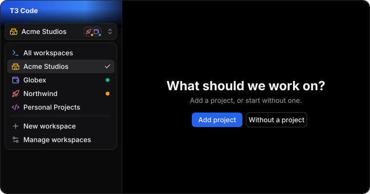

<div align="center">



# T3 Code with Workspaces

An unofficial fork of [T3 Code](https://github.com/pingdotgg/t3code) that gives every client or project its own threads and projects, on top of your normal setup.

[](https://github.com/camdencove/t3code/releases/latest)
[](./LICENSE)

**[Download](https://github.com/camdencove/t3code/releases/latest)** · [Run it on a server](#run-it-on-a-server) · [Upstream docs](#t3-code)

</div>

## Workspaces

If you work across several clients or companies, their threads should not share one pile. A workspace keeps them apart and inherits everything else from Default.

- **Inherits by default.** Each workspace runs its own T3 Code server with its own projects and threads. It uses your existing logins, tools and MCP servers, and starts with a copy of your T3 Code settings, so it works straight away.
- **Separate what you need.** Turn on separate Claude, Codex or GitHub CLI config under **Settings → Workspaces**, then sign in with that tool's own login command in a terminal in the workspace, such as `claude auth login`. Existing threads for that tool can't continue after you change this.
- **Override anything else.** Add environment variables per workspace, such as `AWS_PROFILE` or `GIT_CONFIG_GLOBAL`.
- **One click to switch.** Pick a workspace from the sidebar or the command palette, or press `mod+alt+w`. **All workspaces** shows everything at once. Every workspace starts with the app, so scheduled tasks keep running. When another workspace is waiting on you, its icon appears on the switcher, and and `mod+alt+j` opens whatever has been waiting longest. `mod+alt+1` to `9` jump straight to a workspace. Set icons, rename Default and All workspaces and drag to reorder under **Settings → Workspaces**.
- **No crossed wires.** New threads stay in the workspace you are in, and load balancing and PR routing leave workspaces out.
- **Remote environments.** An SSH or paired server shows in every workspace by default. To keep it in one workspace, pick that workspace under **Settings → Workspaces**. Agents there use that server's logins, so a workspace's separate logins and environment variables don't apply.

To keep client MCP servers apart without a separate login, skip global servers and define them per project: `claude mcp add --scope local`, or a `.mcp.json` in the repo. A `.mcp.json` in a parent folder also works, but not in worktrees outside that folder.

Only what you turn on is separate. Cursor, OpenCode, Grok, Kiro, Antigravity, your git identity and your SSH keys always come from your normal setup unless you override them with environment variables.

Workspaces are a desktop app feature. To use one from another device, turn on **Network access** under **Settings → Sharing & access**, then choose **Copy pairing link** on that workspace under **Settings → Workspaces** and paste the link into **Add environment** on the other device. Each workspace is paired on its own, and any environment you add appears in the switcher with its own icon and shortcut.

## Download

Grab the installer for your machine from the [latest release](https://github.com/camdencove/t3code/releases/latest). Windows x64, macOS Apple Silicon and Linux (x64 and arm64) are all there.

The builds are unsigned, so Windows and macOS will warn you the first time you open the app. On Windows choose **More info**, then **Run anyway**. On macOS allow it under **System Settings → Privacy & Security**.

## Run it on a server

The easy way is SSH from the desktop app. Open **Settings → Connections**, add an environment, choose **SSH** and enter your host, such as `user@example.com`. T3 Code installs the matching CLI on the server, starts it and forwards the port for you.

To install the CLI yourself:

```bash
curl -fsSL https://raw.githubusercontent.com/camdencove/t3code/main/scripts/install.sh | sh
```

Then run `t3`. The server needs Linux or an Apple Silicon Mac, plus your agent's CLI signed in. The [remote access guide](./docs/user/remote-access.md) has the details.

## How this fork differs

- **T3 Connect is off.** It depends on T3's hosted services, so use SSH, your LAN or Tailscale.
- **Telemetry works as it does upstream.** Set `T3CODE_TELEMETRY_ENABLED=false` to turn it off.
- **Upstream changes come in by merge.** The fork stays a small set of commits on top of T3 Code.

All credit for T3 Code goes to its [authors](https://github.com/pingdotgg/t3code). This fork is not affiliated with or supported by them, so please report fork issues [here](https://github.com/camdencove/t3code/issues). Released under the [MIT License](./LICENSE).

---

_The rest of this page is the upstream README. Its install commands and links point to the official T3 Code, without workspaces._

# T3 Code

T3 Code is an "agent harness control surface". It enables control of the agents on your machine with a best-in-class mobile app ([iOS](https://apps.apple.com/us/app/t3-code-remote-claude-more/id6787819824), [Android](https://play.google.com/store/apps/details?id=com.t3tools.t3code)), [web app](https://app.t3.codes) and [Electron-based desktop app](https://t3.codes).

Works with your subscriptions on Claude Code, Codex, Cursor, Grok Build, OpenCode, Google Antigravity, and fx. If they're set up on your computer, T3 Code can control them.

## "Wait, what are you selling me?"

Nothing. We built T3 Code because we wanted the best possible development experience with agents. We were inspired by existing solutions like the Codex desktop app, Conductor, Claude Desktop and Cursor Glass, but none met our bar.

We wanted something performant, remote-ready, and truly open. If we ever go the wrong direction, we want you to have everything you need to fork and build the editor that you want.

## Installation

> [!WARNING]
> T3 Code currently supports Codex, Claude, Cursor, Grok Build, OpenCode, Antigravity, and fx. Install and authenticate at least one provider before use:
>
> - Codex: install [Codex CLI](https://developers.openai.com/codex/cli) and run `codex login`
> - Claude: install [Claude Code](https://claude.com/product/claude-code) and run `claude auth login`
> - Cursor: install [Cursor CLI](https://cursor.com/cli) and run `agent login`
> - Grok Build: install [Grok Build CLI](https://x.ai/cli) and run `grok login`
> - OpenCode: install [OpenCode](https://opencode.ai) and run `opencode auth login`
> - Antigravity: enable it in Settings, then use **Install Antigravity** and **Sign in with Google**. No CLI is required.
> - fx: install [fx](https://fx.sh) and run `fx login` on the machine running the T3 Code server ([setup guide](./docs/user/providers-fx.md))

### Command line

```bash
curl -fsSL https://t3.codes/install.sh | sh
```

On Windows, in PowerShell:

```powershell
irm https://t3.codes/install.ps1 | iex
```

Then run `t3` to start the server and open the local web app. `t3 service install` keeps it running in the background, `t3 update` moves to a newer release, and `t3 --help` has the full reference.

To try it once without installing, run `npx t3@latest` instead.

### Desktop app

Install the latest version of the desktop app from [GitHub Releases](https://github.com/pingdotgg/t3code/releases), or from your favorite package registry:

#### Windows (`winget`)

```bash
winget install T3Tools.T3Code
```

#### Windows (`scoop`)

```bash
scoop install extras/t3code
```

#### macOS (Homebrew)

```bash
brew install --cask t3-code
```

#### Debian, Ubuntu (`.deb`)

Download the `.deb` from [GitHub Releases](https://github.com/pingdotgg/t3code/releases), then:

```bash
sudo apt install ./T3-Code-*.deb
```

#### Arch Linux (AUR)

Stable:

```bash
yay -S t3code-bin
```

Nightly:

```bash
yay -S t3code-nightly-bin
```

The AUR packaging is maintained in this repository under [`packaging/aur`](./packaging/aur).

#### Nix (nixpkgs)

```bash
nix profile add github:NixOS/nixpkgs/nixos-unstable#t3code
```

The package is maintained in [nixpkgs](https://github.com/NixOS/nixpkgs/tree/nixos-unstable/pkgs/by-name/t3/t3code)
and includes the desktop app (`t3code-desktop`) and the `t3` command.
See [Nix installation](./docs/user/install.md#nix-nixpkgs) for NixOS configuration and updates.

## Some notes

We are very very early in this project. Expect bugs.

We are (mostly) not accepting contributions yet. Small fixes may be considered. Big features will not be.

## Documentation

Full docs live in [docs/](./docs). There's no docs site yet.

- [FAQ](./docs/user/faq.md)
- [Install and first run](./docs/user/install.md)
- [Permission modes](./docs/user/permission-modes.md)
- [Keyboard shortcuts](./docs/user/keybindings.md)
- [Project settings](./docs/user/project-settings.md)
- [Appearance preferences](./docs/user/appearance.md)
- [Remote access from a phone or another machine](./docs/user/remote-access.md)
- [Connect Claude Code, Codex, ChatGPT and other agents over MCP](./docs/user/outside-agents.md)
- [Keeping app and server in sync](./docs/user/updating.md)
- [Source control integrations](./docs/user/source-control.md)
- Multiple accounts: [Codex](./docs/user/providers-codex.md) · [Claude](./docs/user/providers-claude.md)
- [Run T3 Code as a background service](./docs/user/background-service.md)

Building from source? Start at [docs/internals/overview.md](./docs/internals/overview.md).

## If you REALLY want to contribute still.... read this first

### Install `vp`

T3 Code uses Vite+ so you'll need to install the global `vp` command-line tool.

#### macOS / Linux

```bash
curl -fsSL https://vite.plus | bash
```

#### Windows

```bash
irm https://vite.plus/ps1 | iex
```

Checkout their getting started guide for more information: https://viteplus.dev/guide/

### Install dependencies

```bash
vp i
```

Read [CONTRIBUTING.md](./CONTRIBUTING.md) before reporting a bug or opening a PR.

Have a feature request? Start an [Ideas discussion](https://github.com/pingdotgg/t3code/discussions/categories/ideas).

Need support? Join the [Discord](https://discord.gg/jn4EGJjrvv).
